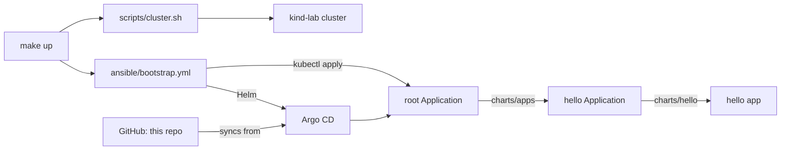

# 01-kind-gitops-bootstrap

## Goal
Learn agentic coding by building a small GitOps bootstrap: one command creates a local kind cluster,
installs Argo CD, and hands over to Git for everything deployed after that.

## Architecture
Ansible installs Argo CD and applies one root application. From then on, Argo CD deploys what's in this repo.



Everything targets the `kind-lab` context by name. The script and playbook refuse any other cluster, and
`make up` puts your current kube context back after kind changes it.

## Prerequisites
- A running Docker daemon (built and tested on Docker Desktop)
- kind, kubectl, helm, ansible (`make` installs the pinned collections into `.collections/`)
- shellcheck, yamllint, ansible-lint (for `make lint`)
- bats-core 1.5+ and jq (for `make test` and `make smoke`): `brew install bats-core jq`. yq and kubeconform
  run from pinned Docker images, so they needn't be installed.

## Run
```bash
make up
```

Argo CD syncs from `main` by default. To test a branch that's been pushed but not merged:

```bash
make up GITOPS_REVISION=feat/my-branch
```

To open the Argo CD UI at https://localhost:8080 (user `admin`):

```bash
kubectl --context kind-lab -n argocd get secret argocd-initial-admin-secret \
  -o jsonpath='{.data.password}' | base64 -d
kubectl --context kind-lab -n argocd port-forward svc/argocd-server 8080:443
```

To see GitOps work, change `message` in `charts/hello/values.yaml`, push it to the revision Argo CD is
tracking, and run `make smoke` once it has synced. If you ran `make up` with `GITOPS_REVISION`, pass the
same value to `make smoke` so it checks that Argo CD is tracking that branch. Run it from a checkout of
that revision: it compares the served page with the chart in your working tree.

## Test
```bash
make lint test  # no cluster needed
make smoke      # checks the running cluster
```

Merging to `main` is the deploy here: Argo CD syncs whatever lands there. So the tests that matter most
run on every PR, before the merge, and CI must pass for a PR to merge.

| Suite | Runs in | Checks | Stops |
|---|---|---|---|
| `tests/charts.bats` | `make test`, CI | The rendered hello and apps charts: non-root, seccomp, no privilege escalation, dropped capabilities, read-only page, requests and limits, probes, a pinned image tag, multi-line messages, checksum-driven rollouts, and the hello Application's revision, path and sync policy | a bad chart before Argo CD sees it |
| kubeconform | `make test`, CI | Every rendered manifest against the Kubernetes schema | invalid manifests |
| `tests/cluster.bats` | `make test`, CI | `scripts/cluster.sh` with fake `kind` and `kubectl`: only ever `kind-lab`, context restored, idempotent | a script that could touch another cluster |
| `tests/playbook_guard.bats` | `make test`, CI | The playbook refuses any context but `kind-lab` | the same, for Ansible |
| `tests/smoke/smoke.bats` | `make smoke` | Argo CD apps Synced/Healthy at the expected revision, and hello serves exactly the page its chart renders | a deploy that didn't land |

`make test` needs Docker and network access for the yq and kubeconform images, but no cluster.

## Teardown
```bash
make down
```

This deletes only the `lab` cluster.

## How this was built
Tested live from a fresh cluster: a one-line `message` change pushed to the branch reached the running app
in 142 seconds, through Argo CD's normal polling.

What the agent did:
- Proposed the milestone plan, then wrote the scripts, playbook, charts, tests, and CI changes.
- Noticed that `kind create` changes the current kube context, and made `make up` restore it.
- Traced an `ansible-lint` failure to ansible and ansible-lint running on different Python installs, then
  pinned the collection in a project-local folder.
- Limited the context guard test to a context that doesn't exist, so a broken guard can't reach a real cluster.

What I steered:
- Set the rule that work only ever targets `kind-lab`, with `kind-multi` off limits.
- Chose Argo CD over Flux.
- Decided to finish the tests and docs before pushing the branch for the first live GitOps test.

Found in review after the first merge, and fixed:
- **Version drift:** the Kubernetes version was pinned in both `kind-config.yaml` and the Makefile, with
  nothing keeping them equal. The Makefile now reads it from `kind-config.yaml` (#2).
- **Multi-line values broke the chart:** a multi-line `message` rendered invalid YAML. Fixed with `nindent`
  (#2), then proven live: a two-line message reached the page 7 seconds after Argo CD was pointed at the
  branch (#4).
- **Smoke test passed too early:** after repointing Argo CD from a branch back to `main`, `make smoke` passed
  while the `hello` app still tracked the branch. It now waits for the revision Argo CD actually compared
  against (#5).
- **Supply chain:** CI actions pinned to commit SHAs rather than movable tags (#7).

Moved to bats, for what this project deploys:
- I asked for bats to gate what's deployed, not just the scripts. The agent ported the two script tests,
  added `charts.bats` as the pre-merge gate on the rendered charts, and rewrote the smoke test.
- **Proof the tests bite:** the agent broke the code on purpose in scratch copies. Three script and
  playbook bugs were each caught by both the old and new tests before the old ones were deleted. Six chart
  bugs (`runAsNonRoot: false`, `indent` for `nindent`, a hard-coded revision, `NET_RAW` instead of `ALL`,
  a `latest` tag, a fixed checksum) were each caught by `charts.bats`.
- **Smoke test is stricter:** it used to pass on any non-empty page. It now requires the exact page the chart
  renders, verified on `kind-lab` along with two runs that must fail.
- **Next:** a kind cluster in CI that installs the hello chart and runs bats against it, so a chart that
  renders but won't run can't merge either.

## In production I'd add
This is a single-user lab. For a real platform team, I'd add:
- **Access:** SSO (OIDC) for Argo CD instead of the initial admin password, plus `AppProject`s and RBAC so
  teams can only deploy to their own namespaces.
- **Secrets:** External Secrets Operator backed by Vault (or Sealed Secrets), so no secret ever lives in Git.
- **Ingress and TLS:** an ingress controller with cert-manager, instead of port-forwarding.
- **Multiple clusters and environments:** ApplicationSets generating apps per cluster and per environment,
  with promotion by pull request.
- **Argo CD itself:** HA mode, and its own config managed by Argo CD (self-managing).
- **Signals:** Argo CD metrics into Prometheus, with alerts on sync failures and degraded health, and
  notifications to chat.
- **Policy:** admission checks (Kyverno or OPA Gatekeeper) enforcing what the hello chart already does:
  non-root, dropped capabilities, resource limits.
