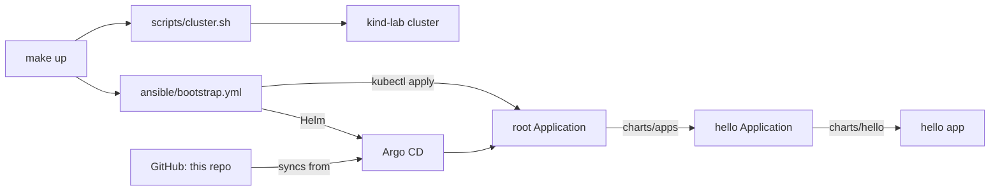

# 01-kind-gitops-bootstrap

## Goal
Learn agentic coding by building a small GitOps bootstrap: one command creates a local kind cluster,
installs Argo CD, and hands over to Git for everything deployed after that.

## Architecture
Ansible installs Argo CD and applies one root application. From then on, Argo CD deploys what's in this repo.



Everything targets the `kind-lab` context by name. The script and playbook refuse any other cluster, and
`make up` puts your current kube context back after kind changes it.

## Prerequisites
- A running Docker daemon (built and tested on Docker Desktop)
- kind, kubectl, helm, ansible (`make` installs the pinned collections into `.collections/`)
- shellcheck, yamllint, ansible-lint (for `make lint`)

## Run
```bash
make up
```

Argo CD syncs from `main` by default. To test a branch that's been pushed but not merged:

```bash
make up GITOPS_REVISION=feat/my-branch
```

To open the Argo CD UI at https://localhost:8080 (user `admin`):

```bash
kubectl --context kind-lab -n argocd get secret argocd-initial-admin-secret \
  -o jsonpath='{.data.password}' | base64 -d
kubectl --context kind-lab -n argocd port-forward svc/argocd-server 8080:443
```

To see GitOps work, change `message` in `charts/hello/values.yaml`, push it to the revision Argo CD is
tracking, and run `make smoke` once it has synced.

## Test
```bash
make lint test  # no cluster needed
make smoke      # checks the running cluster
```

`make test` runs the script tests with fake `kind` and `kubectl` binaries, checks the playbook's syntax and
context guard, and validates the rendered charts with kubeconform. It needs Docker and network access for
kubeconform, but no cluster.

## Teardown
```bash
make down
```

This deletes only the `lab` cluster.

## How this was built
Status: the end-to-end sync from Git hasn't been tested live yet.

What the agent did:
- Proposed the milestone plan, then wrote the scripts, playbook, charts, tests, and CI changes.
- Noticed that `kind create` changes the current kube context, and made `make up` restore it.
- Traced an `ansible-lint` failure to ansible and ansible-lint running on different Python installs, then
  pinned the collection in a project-local folder.
- Limited the context guard test to a context that doesn't exist, so a broken guard can't reach a real cluster.

What I steered:
- Set the rule that work only ever targets `kind-lab`, with `kind-multi` off limits.
- Chose Argo CD over Flux.
- Chose Docker Desktop over starting colima.
- Decided to finish the tests and docs before pushing the branch for the first live GitOps test.
