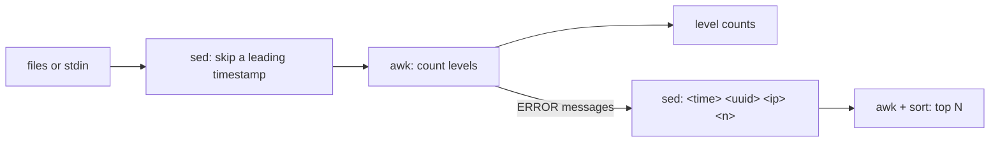

# 02-bash-toolkit

## Goal
Build a small Bash toolkit test-first: the bats tests are written before the code, so failing tests
define "done". Two everyday SRE tools came out of it:

- **`cert-expiry`**: how long the TLS cert at each `host:port` has left, Nagios-style.
- **`log-triage`**: level counts and the top recurring errors from `LEVEL message` logs.

### What this project is, and isn't
The point of 02 is the **test-first pattern**. The two tools are the subject the pattern was practised on,
not part of a deploy pipeline. The bats tests here gate the tools' own code in CI. The tools themselves
are runtime checks, and that work belongs in monitoring, not CI/CD:

- **`cert-expiry`** is a Nagios-style check plugin: useful under NRPE/Icinga or cron on hosts without
  Prometheus, or as a post-deploy check that an ingress serves a cert with enough days left. Where
  Prometheus runs, the blackbox exporter already does this, and certs are best watched where they're
  issued and stored (cert-manager, Vault PKI).
- **`log-triage`** is for quick triage on a box, or a canary gate before promotion
  (`kubectl logs deploy/app | log-triage --max-errors 0`). Ongoing, log-based alerting (Loki,
  Alertmanager) does this job.

bats tests for what this repo actually deploys, such as the hello chart and its live smoke test, live
with that project: see [project 01](../01-kind-gitops-bootstrap/).

## Architecture
Each tool is a single Bash script in `bin/`, with its spec in `tests/`:

| Tool | Spec | How it works |
|---|---|---|
| `bin/cert-expiry` | `tests/cert_expiry.bats` | `openssl s_client` fetches each leaf cert, with SNI. A background watchdog enforces `--timeout`, since macOS has no `timeout` command. |
| `bin/log-triage` | `tests/log_triage.bats` | One pipeline, shown below. Handles 100k lines in under a second. |



Both tools use the same Nagios exit codes, so they drop into a monitoring check or a cron job as-is:

| Exit | `cert-expiry` | `log-triage` |
|---|---|---|
| 0 OK | every cert has more than `--warn` days left | errors within `--max-errors` |
| 1 WARN | a cert has `--warn` days or fewer left (default 60) | not used |
| 2 CRIT | a cert has fewer than `--crit` days left (default 30), or has expired | more errors than `--max-errors` |
| 3 UNKNOWN | no cert within `--timeout`, or a usage error | unreadable file, or a usage error |

With several targets, `cert-expiry` exits with the worst result, ranked CRIT, then UNKNOWN, then WARN.

### How the tests avoid the network and the clock
- **TLS servers:** `tests/tls_fixture.bash` starts local `openssl s_server` processes on 127.0.0.1, on
  ports the OS picks, serving certs with fixed expiry dates. `openssl ca` makes those certs, because
  OpenSSL 3.0 (on CI) can't set an exact expiry date with `req -x509`.
- **A hung endpoint:** a short `python3` listener accepts connections and never answers, to test
  `--timeout`.
- **The clock:** `CERT_EXPIRY_NOW` (epoch seconds) stands in for the current time, so tests like
  "exactly 60 days left is WARN" are exact. One test uses the real clock.

## Prerequisites
- bash 4.2+, make, openssl
- bats-core 1.5+ (for `make test`; built with 1.14.0, which CI pins): `brew install bats-core`
- python3 (for `make test`, the hung-server fixture only)
- shellcheck (for `make lint`)

## Run
No install step; the scripts run from `bin/`.

```console
$ bin/cert-expiry github.com:443 example.com:443 127.0.0.1:1
OK github.com:443 65 days left (expires 2027-01-27)
WARN example.com:443 31 days left (expires 2026-12-25)
UNKNOWN 127.0.0.1:1 could not fetch a certificate
$ echo $?
3
```

```console
$ bin/log-triage --max-errors 2 app.log
ERROR 3
WARN  1
INFO  2
DEBUG 0
OTHER 0

Top errors:
    2  connection refused from <ip>:<n>
    1  job <uuid> failed after <n> retries
$ echo $?
2
```

`log-triage` reads stdin when no files are given (`journalctl -u app | bin/log-triage`). See `--help`
on either tool for every option.

## Test
```bash
make lint test
```

`make test` runs every `.bats` file in `tests/`: 49 tests, about 6 seconds, no network needed.

## Teardown
Nothing to tear down: the tests stop their own servers, and the toolkit starts no services.

## How this was built
Test-first, one milestone at a time. Each tool got a commit of failing tests, which I reviewed before
any code existed, then a commit that made them pass. `git log` shows the order.

What the agent did:
- Wrote the specs as bats tests, with fixtures that need no network: local TLS servers serving fixed
  expiry dates, a silent listener for timeouts, and an injectable clock for exact boundaries.
- Proved each fixture on OpenSSL 4.1 (macOS) and 3.0 (Ubuntu) before relying on it.
- Wrote both scripts. Every test passed on the first run, so the agent then checked the tests themselves:
  - **Mutation tests:** broke the code on purpose in scratch copies. Changing CRIT from `<` to `<=`,
    dropping the timestamp strip, and normalizing numbers before IPs were each caught by a test.
  - **CI parity:** ran `make lint test` in an `ubuntu:24.04` container (GNU `date`, OpenSSL 3.0,
    mawk, shellcheck 0.9). That caught a shellcheck 0.9 warning that the newer shellcheck on macOS
    doesn't give, before it could break CI.
  - **Leftovers:** checked that no `s_server`, listener, or watchdog `sleep` survives a test run.
- Kept the scripts portable between macOS and Linux: GNU and BSD `date`, regexes with `{n}` in `sed -E`
  rather than mawk, `LC_ALL=C` for stable sorting, and no `head` after `sort` under `pipefail`.

What I steered:
- Picked the thresholds: WARN at 60 days, CRIT under 30. Kept `cert-expiry` to `host:port` only.
- Had `log-triage` use Nagios exit codes too, so both tools behave the same under monitoring.
- Asked for `--timeout`, after the agent flagged that a hung endpoint would hang a cron job.
- Asked for timestamps before the level to be handled, since that's how most real logs look.
- Chose system bats from Homebrew, with CI pinned to the same version, over vendoring it.
- Kept moving project 01's tests onto bats for a separate PR.

## In production I'd add
- **Packaging:** install to `/usr/local/bin` with a Makefile `install` target, or ship as a package.
- **cert-expiry:** check the whole chain, not just the leaf; IPv6 targets (`[::1]:443`); STARTTLS for
  SMTP and LDAP; Prometheus output (or just run the blackbox exporter, which already does this).
- **log-triage:** syslog and JSON-lines formats, gzipped input, and a time window (`--since 1h`).
- **Alerting:** run both from the monitoring system, not cron, so results land where on-call looks.
